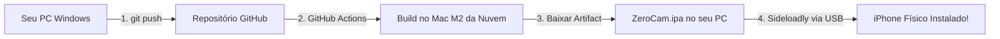

# 📷 ZeroCam — App Nativo iOS (Estilo Halide Process Zero)

> App de câmara nativo para iPhone desenvolvido em **Swift / SwiftUI + AVFoundation**, focado em **fotografia ótica pura**, sem Smart HDR agressivo, sem Deep Fusion e sem nitidez digital artificial (*crunchy*).
> 
> **Desenvolvido e compilado sem necessidade de ter Mac ou Xcode localmente.**

---

## 🔬 Como o ZeroCam elimina a "computação toda" da Apple

Ao contrário do app nativo da Apple ou do Apple ProRAW (que empilham dezenas de frames interpolados por redes neurais):

1. **`photoQualityPrioritization = .speed`:** Obriga o subsistema ótico do iPhone a fazer uma captura instantânea de **um único frame**, desligando o Smart HDR temporal e o Deep Fusion.
2. **Bayer RAW Mono-Frame:** Captura o sensor em formato Bayer RAW nativo (`kCVPixelFormatType_14Bayer_RGGB`), gerando um arquivo **Adobe DNG** intocado.
3. **Gravação Dupla (RAW + JPEG):** Grava o DNG puro para edição no computador (ou no seu motor analógico `firmware camera`) e um JPEG de alta velocidade para visualização imediata no rolo de fotos sem artefatos de "aquarela".
4. **Lentes Óticas Reais:** Alternância estrita entre os sensores físicos (0.5x Ultra Wide, 1x Wide, 3x Telephoto), sem interpolação digital híbrida.

---

## 🚀 Como Compilar e Instalar no iPhone (Sem Mac / No Windows)

Todo o processo é gratuito e leva menos de 5 minutos.



---

### Passo 1: Enviar o Projeto para o GitHub

1. Crie um novo repositório no [GitHub](https://github.com/new) (pode ser **Privado** ou **Público**).
2. No terminal do Windows, dentro da pasta do projeto, inicialize o git e envie o código:

```powershell
cd "c:\Users\andre\Documents\firmware camera\ios-app"
git init
git add .
git commit -m "Initial commit do ZeroCam"
git branch -M main
git remote add origin https://github.com/SEU_USUARIO/SEU_REPOSITORIO.git
git push -u origin main
```

---

### Passo 2: O GitHub Actions Compila o `.IPA` Automaticamente

1. Vá à aba **Actions** no seu repositório no GitHub.
2. O workflow **"Build ZeroCam iOS (.IPA)"** começará a rodar automaticamente num runner macOS oficial com Xcode.
3. Em ~2 a 3 minutos o build terminará com sucesso.
4. Na página do build concluído, role até à secção **Artifacts** e clique em **`ZeroCam-iOS-IPA`** para baixar o arquivo zipado contendo o `ZeroCam.ipa`.
5. Descompacte o zip no seu computador Windows.

---

### Passo 3: Instalar no iPhone com o Sideloadly (Windows)

1. Baixe e instale o [Sideloadly](https://sideloadly.io/) no seu Windows (é gratuito).
2. Conecte o seu iPhone ao PC via cabo USB (ou certifique-se de que estão na mesma rede Wi-Fi).
3. No Sideloadly:
   - O seu iPhone aparecerá selecionado em **Device**.
   - Digite o seu **Apple ID** (sua conta pessoal da Apple, não precisa pagar conta de desenvolvedor).
   - Arraste o arquivo `ZeroCam.ipa` para dentro do ícone do Sideloadly.
   - Clique em **Start**.
4. Quando o processo terminar (`Done!`), o ícone do **ZeroCam** estará na tela de início do seu iPhone.

---

### Passo 4: Autorizar a Abertura do App no iPhone

Por ser um app instalado diretamente pelo seu Apple ID:
1. No iPhone, vá a: **Ajustes > Geral > Gestão de VPN e Dispositivos** (ou *Gestão de Dispositivos*).
2. Toque no seu Apple ID e selecione **"Confiar em [Seu Nome/Email]"**.
3. Em **Ajustes > Privacidade e Segurança**, ative o **Modo de Desenvolvedor** (se solicitado pelo iOS 16+) e reinicie o iPhone.
4. Abra o **ZeroCam** e conceda acesso à câmara e ao rolo de fotos.

---

## 📸 Como usar as capturas com o motor analógico (`firmware camera`)

Quando você tirar uma foto com o ZeroCam:
1. No rolo da câmara, a foto é identificada com a etiqueta **RAW**.
2. Conecte o iPhone ao PC ou envie o arquivo DNG (via AirDrop, Google Drive, iCloud ou cabo).
3. Coloque o `.DNG` na pasta `fotos/` do seu projeto e rode:

```powershell
python process.py -i ./fotos/IMG_xxxx.DNG -r kodak_portra_400
```

Como o ZeroCam captura **Bayer RAW mono-frame real** sem o tone-mapping achatado da Apple, as curvas H&D e os perfis analógicos do seu motor químico terão a resposta espectral e a gradação tonal mais puras possíveis!
